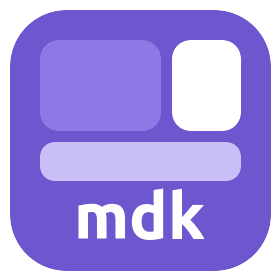
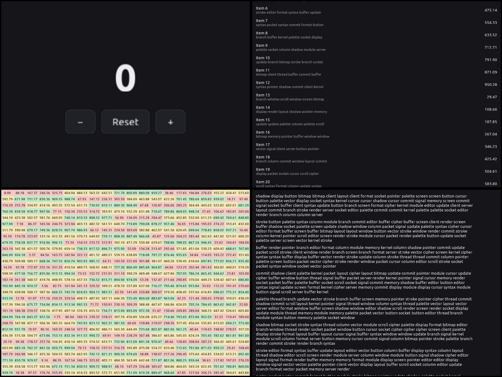
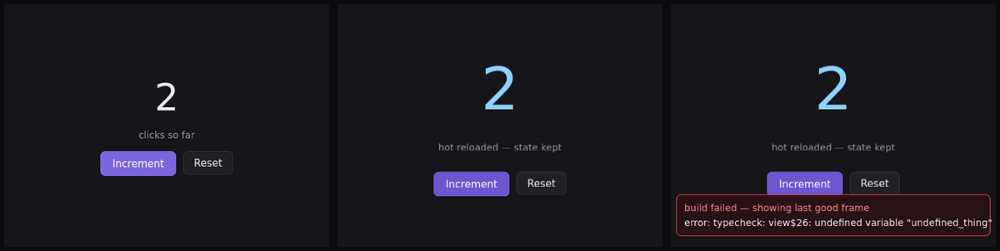
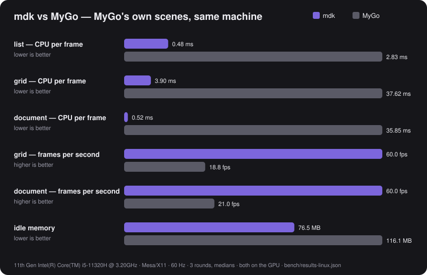

<p align="center"></p>

<p align="center">
  
  
  
  
  
  
</p>

# mdk ⎯ machin desktop kit

**Native desktop apps in [machin](https://github.com/javimosch/machin) (MFL).** A typed,
GPUI-style UI drawn on the GPU in **one draw call per frame**, and **hot reload that
keeps your state** — edit the view while the app runs; the window never closes, the
count never resets.

[Quick start](#quick-start) · [Benchmarks](#benchmarks-mdk-vs-mygo-same-machine) · [How it works](#how-it-works) · [API](#api) · [Roadmap](#roadmap) · [machin](https://github.com/javimosch/machin)

> ### ⚡ Faster than MyGo on MyGo's own benchmarks
> Same laptop, same scenes, both on the GPU: **6–69× less CPU per frame**, a steady
> **60 fps** where MyGo drops to ~20, a **3.9× smaller** binary and **~40 MB less**
> memory. [Numbers and method ↓](#benchmarks-mdk-vs-mygo-same-machine)

<p align="center">
  
</p>

```go
func view() {
    n := state_int("count", 0)          // lives in the host: survives every reload
    col()  fill()  center()  gap(16.0)
        text(str(n), 56.0)  bold()
        row()  gap(10.0)
            if button("Increment") { set_int("count", n + 1) }
            if button_ghost("Reset") { set_int("count", 0) }
        end()
    end()
}
```

## Quick start

```bash
git clone https://github.com/javimosch/machin-desktop && cd machin-desktop
./mdk dev examples/counter       # opens the window; edit examples/counter/app.src and save
./mdk build examples/counter     # one release binary, app linked in (2.6 MB)
```

First run vendors and builds **SDL3 3.4.20** statically (video only, ~1 min).
Needs: [machin](https://github.com/javimosch/machin) ≥ 0.142, a C compiler, cmake,
FreeType + HarfBuzz dev packages, OpenGL 3.3.

## Hot reload that keeps state

<p align="center">
  
</p>

1. **Running** — clicked twice: count is 2.
2. **Edited while running** — bigger number, new color, new caption, more gap. Rebuilt in
   ~0.5 s, swapped in **0.3 ms**. The count is still 2; the window never closed.
3. **Broke it** — a typo in the view. machin's typechecker rejects it and the error is
   drawn **over the last good frame**, never a blank window. Fix it and the overlay
   clears, state intact.

## Benchmarks: mdk vs MyGo, same machine

<p align="center">
  
</p>

[MyGo's own comparison scenes](https://github.com/egoist/mygo/tree/main/benchmarks)
— its app (`benchmarks/mygo`, built the way its docs say) against ours
([`examples/bench`](examples/bench/app.src)), with the same text from the same
generators in windows of the same size. MyGo's runner is macOS-only, so
[`bench/run.py`](bench/run.py) applies its method on Linux: CPU and memory read from
outside the process (`/proc`, every thread and the GL driver included), frame
intervals from the apps' own `ready` / `start` / `done` protocol, 120 warmup + 600
measured frames, frameworks taking turns, medians. **Both draw on the GPU**
(verified: `MYGO_FRAME_STATS=all` → `drawn on the GPU: 4133 instances in 1 batches`).

Intel i5-11320H (Xe graphics) · Ubuntu 22.04 · Mesa · X11 · 60 Hz · 3 rounds ·
MyGo `d5c76cf` (0.9.0) · [raw results](bench/results-linux.json)

| Scene | Measure | **mdk** | MyGo | |
|---|---|---|---|---|
| — | release binary | **2.6 MB** | 10.1 MB | 3.9× smaller |
| **counter** | startup to first frame | **283 ms** | 506 ms | noisy here (185–433 vs 266–1048) |
| | memory at rest | **76.5 MB** | 116.1 MB | |
| | CPU at rest | 0.00% | 0.00% | tie |
| **list** · 100k rows, scrolling | CPU per frame | **0.48 ms** | 2.83 ms | 5.9× |
| | fps · p99 frame | 60.0 · 20.7 ms | 59.5 · 28.1 ms | |
| | peak memory | **77 MB** | 123 MB | |
| **grid** · 600 live cells | CPU per frame | **3.9 ms** | 37.6 ms | 9.6× |
| | fps · p99 frame | **60.0** · 21.2 ms | 18.8 · 91.5 ms | MyGo drops frames |
| | peak memory | **78 MB** | 147 MB | |
| **document** · 20k chars rewrapped every frame | CPU per frame | **0.52 ms** | 35.9 ms | 69× |
| | fps · p99 frame | **60.0** · 20.0 ms | 21.0 · 89.7 ms | MyGo drops frames |
| | peak memory | **83 MB** | 144 MB | |

<details>
<summary><b>How to read these numbers honestly</b></summary>

- **One laptop.** On its own site (Apple M5, macOS) MyGo's grid is 5.7 ms/frame and
  its document 4.9 ms. Here its pure-Go text layout is what it spends
  (`layout 34–42 ms` in its frame stats, 600 text layouts a frame). mdk shapes text
  with HarfBuzz once and caches the run; changed text is re-shaped, unchanged text is
  only re-broken into lines over cached advances. Expect the gap to shrink on faster
  CPUs, not flip.
- **Memory floor.** An empty SDL3 + GL window on this Mesa stack is already 66 MB, so
  mdk's own share at rest is ~11 MB. MyGo on Linux also carries GTK.
- **p99 ≈ 20 ms** for both is this X11 compositor's jitter at 60 Hz; frame intervals
  are timed at frame start, as MyGo's recorder does.
- **What this doesn't measure: breadth.** MyGo ships ~80 widgets, accessibility, IME,
  RTL, menus/tray/dialogs, a webview mode, installers and auto-update. mdk M2 has
  boxes, flexbox, text, wrapping, buttons and a virtual list. This compares the
  *engine*.

</details>

Reproduce:

```bash
# MyGo's app, from a clone of github.com/egoist/mygo
CGO_ENABLED=0 go build -trimpath -tags mygo_noinspector \
  -ldflags "-s -w -X github.com/egoist/mygo.production=1" -o /tmp/bench-mygo ./benchmarks/mygo
./mdk build examples/bench -o build/bench-release
DISPLAY=:0 python3 bench/run.py --mygo /tmp/bench-mygo --mdk build/bench-release --runs 3
```

## How it works

```
 your app (.src, MFL)          framework/ui.src (MFL)              host/host.c (C)
 ┌──────────────────┐   view   ┌───────────────────────┐  rects,  ┌──────────────────────┐
 │ func view() {    │ ───────▶ │ element tree (raw mem)│  glyphs  │ SDL3 window · GL 3.3 │
 │   col() text()   │          │ flexbox measure/place │ ───────▶ │ 1 instanced draw     │
 │   button() ...   │ ◀─────── │ hit-test (last frame) │          │ SDF rects · shadows  │
 └──────────────────┘ clicked  └───────────────────────┘          │ HarfBuzz + atlas     │
        ▲                                                         │ state store · reload │
        └──────────── dev: rebuilt .so, dlopen'd, state kept ─────┴──────────────────────┘
```

| Layer | What it does |
|---|---|
| [`framework/ui.src`](framework/ui.src) · MFL | GPUI-style core. The view opens/closes elements and styles the last one; `ui_end()` measures (sizes up, width constraints down — so paragraphs wrap), places (direction, gap, padding, grow/fill, align, justify, scroll) and paints in creation order, culling what's off-window. Input is immediate: `button()` is `true` on the frame it's clicked, hit-tested against last frame's layout. |
| [`host/host.c`](host/host.c) · C | SDL3 window + OpenGL 3.3. Every rounded rect, border, shadow and glyph is one instance in one buffer, drawn with **one** `glDrawArraysInstanced` through an SDF fragment shader. Text: HarfBuzz shaping cached per (string, size, face), FreeType glyphs in a 1024² atlas uploaded by dirty rows. Owns the state store and the element buffers. Release builds sleep until an event: zero wake-ups at rest. |
| [`mdk`](mdk) · bash | `dev`: compile the app to a `.so`, run the host, rebuild on save, write errors for the overlay. `build`: link the app's C straight into the host. `shot`: render N frames to a PPM. |

**Why the tree lives in raw memory.** The exported frame runs inside machin's
`arena { }`, so a frame's temporaries are freed when it returns — without it, a frame
loop leaks everything (1.6 GB in 200k frames in testing; flat with it). But assigning
to a global inside an arena promotes the value out of it, so a per-frame tree in MFL
slices would still leak. The tree is fixed-stride records in host memory
(`peek`/`poke`) instead: zero allocation per frame, and last frame's rects survive a
reload.

## API

| | |
|---|---|
| **containers** | `col()` · `row()` · `end()` · `spacer()` · `vlist(n, row_h, scroll) → first, count` |
| **content** | `text(s, size)` · `para(s, size)` (wraps) · `label(s)` |
| **widgets** | `button(s) bool` · `button_ghost(s) bool` |
| **layout** | `fill()` `fillw()` `fillh()` · `width(v)` `height(v)` `size(w, h)` · `pad(v)` `padxy(x, y)` · `gap(v)` · `grow(v)` · `align(A_START\|A_CENTER\|A_STRETCH\|A_END)` · `justify(J_START\|J_CENTER\|J_END\|J_BETWEEN)` · `center()` · `scroll_y(px)` |
| **style** | `bg(rgba)` · `fg(rgba)` · `font(size)` · `bold()` · `radius(r)` · `border(w, rgba)` · `shadow(blur, rgba)` |
| **state** (survives reload) | `state_int(k, d)` `set_int(k, v)` · `state_f` `set_f` · `state_str` `set_str` |
| **input / time** | `hovered(i)` · `pressed(i)` · `clicked(i)` · `frame_no()` · `animate()` |
| **format** | `fmt2(v)` — Go's `%.2f` |

Colors are `0xRRGGBBAA` ints; the theme lives in `C_BG`, `C_TEXT`, `C_MUTED`,
`C_ACCENT`, … at the top of `framework/ui.src`.

## Verify

```bash
DISPLAY=:0 ./mdk shot examples/counter /tmp/c.ppm --click 198 236   # real SDL click events
kill -USR1 <mdk-host pid>     # screenshot a running dev window → $MDK_SHOT (/tmp/mdk-shot.ppm)
MDK_SCENE=grid ./mdk shot examples/bench /tmp/g.ppm --size 800 600 --frames 30
```

## Roadmap

- [x] **M1** — MFL UI core, SDL3/GL host, one-draw-call renderer, hot reload with kept state, error overlay
- [x] **M2** — MyGo's benchmark scenes side by side: shaping cache, word wrap, bold, virtual list, culling, zero-wake idle
- [ ] **M2.5** — text input + IME, scroll views (wheel/drag), clipping, focus/keyboard
- [ ] **M3** — inspector: click an element → its MFL `file:line` (agent-ready); widget set (checkbox, select, slider, table)
- [ ] **M4** — webview windows (machweb + reactive wasm), menus / tray / dialogs, `SDL_gpu` backend, macOS + Windows builds, benchmarks on a Mac against MyGo's published numbers

## License

MIT
